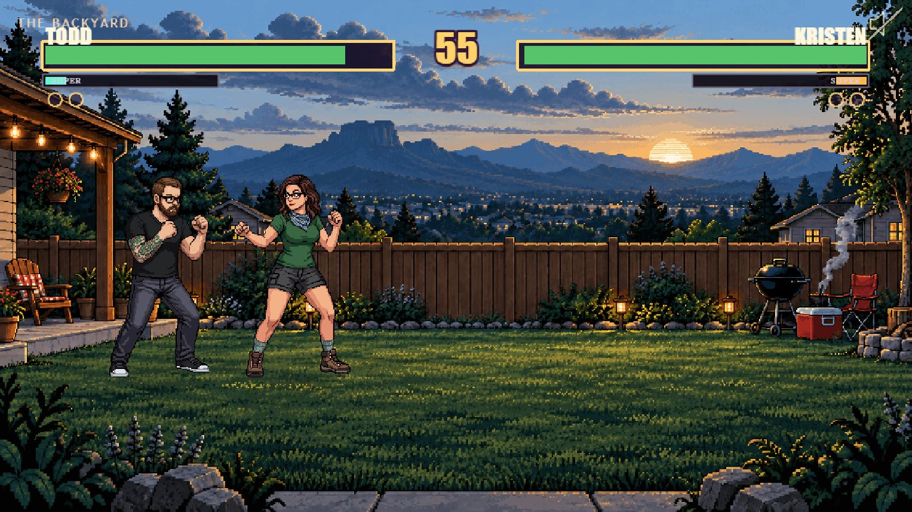
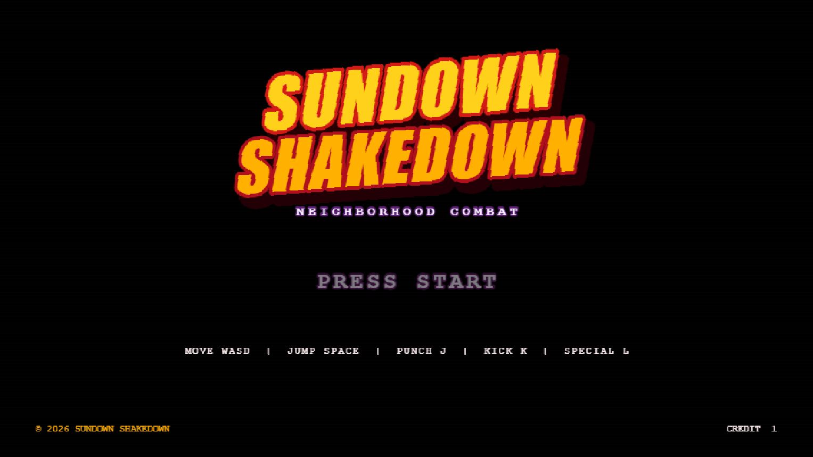
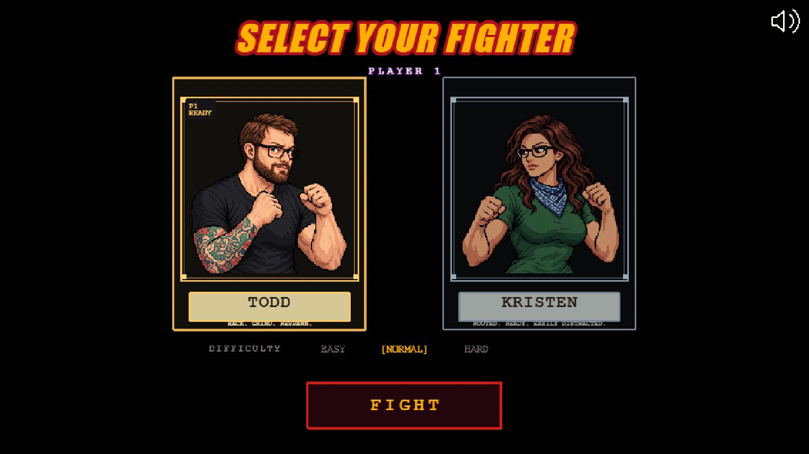

# Sundown Shakedown

**Neighborhood combat. Backyard bragging rights.**

A browser-first, 2D arcade fighting game starring Todd and Kristen. Detailed late-1990s pixel art, hobby-inspired powers, and a good-natured neighborhood roast meet quick matches you can play with a keyboard, mouse, or phone touchscreen.



## The game

Choose your fighter, set the difficulty, and settle things in the Backyard.

- **Two playable fighters:** Todd brings the technology-and-gaming attitude; Kristen brings plants, cooking, and camping energy.
- **Solo arcade matches:** face the other fighter's AI on Easy, Normal, or Hard. First to two round wins takes the match, with 60 seconds per round and quick rematches.
- **Movement and combat:** jump, crouch, guard by holding away, land ground and air attacks, and unleash a Super when the meter fills.
- **Pixel-art presentation:** a mountain-view Backyard, animated fighters, character portraits, hit effects, and individual victory animations.
- **Music:** “High-Altitude Showdown” loops through selection and matches; click the speaker or press M to mute the music.
- **Desktop and mobile input:** a fitted 16:9 canvas, landscape phone layout, and touch D-pad plus four action buttons.

The current slice is single-player against AI on one stage. Online PvP, gamepad support, additional stages and characters, and saved progression are planned. Character-specific Super presentation and stronger impact audio remain in progress.

## Screenshots

Captured from the local playable build on November 25, 2026.

| Arcade title | Fighter selection |
|---|---|
|  |  |

## Full technology stack

The game runs entirely in the browser. The current playable slice requires no application server, database, accounts, or multiplayer service.

| Layer | Technology | Role |
|---|---|---|
| Game framework | **Phaser 4.2.1** | Scenes, sprite animation, input, scaling, and WebGL/Canvas rendering via `Phaser.AUTO` |
| Game code | **TypeScript 7.0.2** | Strictly checked ES2022 modules; shared combat rules, AI, content definitions, and presentation |
| Page and layout | **HTML5 + CSS** | Game host, responsive 16:9 layout, safe-area handling, and portrait rotation guidance |
| Audio | **Phaser sound + Web Audio API** | Looping MP3 soundtrack and synthesized combat sounds |
| Development and build | **Vite 8.3.1** | Local dev server, hot reload, production bundling, and local build preview |
| Tests | **Vitest 5.0.3** | Combat, match state, input, layout, and content validation |
| Tooling runtime | **Node.js + npm** | Dependency management, build/test commands, and local asset scripts |
| Asset processing | **Sharp 0.35.5** | Node-only image preparation and sprite exports |
| Art generation tooling | **PixelLab API + local `.mjs` scripts** | Optional source-art workflow, separate from browser runtime |

Versions reflect the installed dependencies and lockfile. PixelLab credentials are only needed for its optional tooling; playing, building, and testing use the checked-in runtime assets.

## Run locally

Use **Node.js 24** with npm. Run these commands from the repository root:

```powershell
npm ci
npm run dev
```

Open the URL printed by Vite. Press **Enter**, **Space**, or the **Press Start** area to begin. Choose Todd or Kristen and a difficulty, then select **Fight**. Character selection also supports Left/Right for fighters, Up/Down for difficulty, and Enter to fight.

For phone testing, use the computer's current LAN address and Vite port on a reachable network, then play in landscape. The server must remain running.

### Commands

| Command | Purpose |
|---|---|
| `npm ci` | Install the dependencies recorded in `package-lock.json` |
| `npm install` | Install dependencies when intentionally updating the dependency tree |
| `npm run dev` | Start Vite with network access enabled |
| `npm test` | Run the Vitest suite once |
| `npm run build` | Type-check and create the production build in `dist/` |
| `npm run preview` | Serve an existing production build locally with network access enabled |
| `npm run assets:prepare` | Regenerate the base stage, character, and brand exports from source art |
| `npm run pixellab -- <command>` | Run optional Node-only PixelLab tooling; see the access guide below |

For a production preview, run `npm run build` followed by `npm run preview` and open its printed URL. Local builds and previews do not publish or update a hosted site.

## Controls

| Action | Keyboard | Mouse | Touch |
|---|---|---|---|
| Move | A/D or Left/Right | — | D-pad Left/Right |
| Crouch | S or Down | — | D-pad Down |
| Kick | K | Left click | Left action button |
| Punch | J | Right click | Top action button |
| Jump | Space | — | Bottom action button |
| Super | L, with a full meter | Middle click, with a full meter | Right action button, when ready |
| Mute/unmute music | M | Speaker icon | Speaker icon |

Hold away from an attacking opponent to guard; otherwise, holding away retreats. Kick and punch also work in the air. While crouching, Kick performs a low kick and grounded Punch is ignored. W/Up and touch D-pad Up are reserved and do not jump. The touch Super button stays visible but dim and inactive until the meter is full.

## Project layout

```text
src/
  main.ts                Browser entry point and viewport sizing
  styles.css             Responsive page and mobile layout
  engine/                Shared combat rules, fighter behavior, and AI
  game/
    scenes/              Title, character selection, and fights
    input/               Input handling and touch controls
    config.ts            Phaser setup and 960 × 540 logical canvas
    layout.ts            Viewport fitting
    session.ts           Fighter and difficulty selection state
  content/
    characters/          Fighter definitions, moves, portraits, and sprites
    stages/              Stage definitions and runtime artwork
    audio/               Soundtrack
art-source/              Editable artwork, experiments, and review material
scripts/                 Node-only asset preparation and PixelLab tools
docs/                    Plans, runtime guidance, and screenshots
```

Tests live alongside the code as `*.test.ts`. Shared combat behavior stays in `src/engine/`; each fighter and stage owns its definitions and assets. Editable artwork stays in `art-source/`, with runtime exports in the relevant content package.

## Project guides

- [Project plan](docs/PROJECT_PLAN.md) — product scope, character direction, art style, architecture, and deferred work.
- [Gameplay and presentation](docs/GAMEPLAY_AND_PRESENTATION.md) — match flow, input, HUD, mobile layout, music, and animation guidance.
- [Todd animation plan](docs/TODD_PIXELLAB_ANIMATION_PLAN.md) — source-art pilot and rebuild workflow; consult current character definitions for live asset mappings.
- [PixelLab access](docs/PIXELLAB_API.md) — optional asset tooling and local credential setup.

The tone is fictionalized and affectionate. Future neighbor or family likenesses need explicit approval, and public builds must omit exact house numbers and identifying home details.
